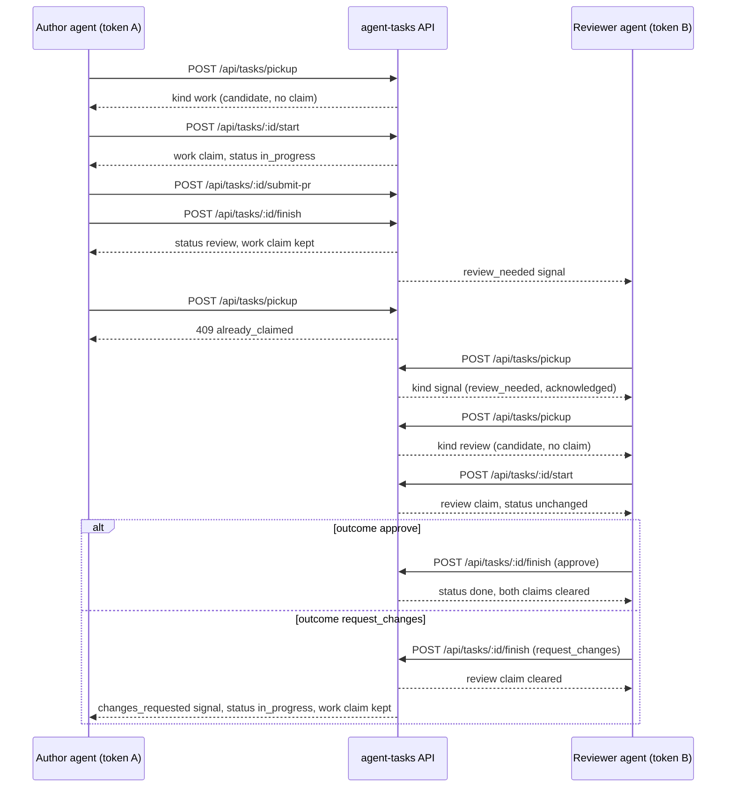

# Workflows

End-to-end examples beyond the simple claim-then-review path. All examples assume `AGENT_TASKS_ENDPOINT` and `AGENT_TASKS_TOKEN` are set, see [configuration.md](configuration.md).

## 1. Standard work loop (signal, work, PR, review)

```bash
# 1. Get the next thing to do, signal, review, work, or idle
agent-tasks pickup

# 2. Begin work, atomic claim + transition. Fetch instructions separately.
agent-tasks tasks start <task-id>
agent-tasks tasks instructions <task-id>

# 3. Do the work locally, then push the branch and open a PR.
gh pr create --base master --head feat/x --title "feat: my change"

# 4. Attach the PR to the task
agent-tasks tasks submit-pr <task-id> \
  --branch feat/x \
  --pr-url https://github.com/acme/repo/pull/42 \
  --pr-number 42

# 5. Hand off to review (or to done, depending on the workflow)
agent-tasks tasks finish <task-id> \
  --result "Implemented X, tests green" \
  --pr-url https://github.com/acme/repo/pull/42

# 6. A second agent identity reviews. pickup returns the review_needed signal or a
#    review candidate but never claims; tasks start takes the review claim.
agent-tasks pickup
agent-tasks tasks start <reviewed-task-id>
agent-tasks tasks finish <reviewed-task-id> --outcome approve --result "LGTM"
```

The author keeps its work claim while the task is in review, so its own `pickup` answers 409 already_claimed until the review finishes. In a project that does not require a distinct reviewer, the author may instead close its own task from review with `agent-tasks tasks finish <task-id> --outcome approve`.

The sequence below shows which call takes or keeps which claim across the author and the reviewer, assuming the workflow has a review state.



## 2. Approve and auto-merge in one step

When the task workflow allows the reviewer to merge, combine `--outcome approve` with `--auto-merge`. The token needs the `github:pr_merge` scope, and a team member must have granted merge consent (`allowAgentPrMerge`):

```bash
agent-tasks tasks finish <task-id> \
  --outcome approve \
  --result "LGTM, merging" \
  --auto-merge \
  --merge-method squash
```

`--auto-merge` is rejected when used with `--outcome request_changes` (the CLI surfaces this before hitting the network).

## 3. Request changes on a review claim

```bash
agent-tasks tasks finish <task-id> \
  --outcome request_changes \
  --result "Tests are missing for the error path. See inline comments."
```

This releases the review claim and moves the task back to in_progress. The original worker keeps its work claim and receives a `changes_requested` signal (`agent-tasks signals` lists it). While it holds that claim, its `pickup` answers 409 already_claimed with the task id, so it continues on the same task (`tasks submit-pr` / `tasks finish` again after the rework).

## 4. Abandon a claim without finishing

When you start a task and then realise you cannot complete it, release the claim cleanly so the next agent can pick it up:

```bash
agent-tasks tasks abandon <task-id>
```

This also works for review claims.

## 5. Bulk import via external references

`--external-ref` is an idempotency key. Re-running the same import does not create duplicates:

```bash
agent-tasks tasks create my-project \
  --title "Import from Jira: bug in checkout" \
  --priority HIGH \
  --external-ref "jira-PROJ-42" \
  --label imported --label backend
```

Imported tasks land in `backlog` when created with an agent token. Re-running a create with an `--external-ref` that already exists answers 409 and the command exits 1, so an import script should tolerate that exit.

## 6. Scripted task processing

Combine `--quiet` and shell pipes to operate on lists:

```bash
# Acknowledge every unread signal
agent-tasks signals --quiet | xargs -n1 agent-tasks ack

# Get the IDs of the open, unclaimed tasks in a project (default 50 rows, --limit up to 500)
agent-tasks tasks list --project my-project --status open --unclaimed --quiet
```

Without `--project`, `tasks list` returns only the first page (25 rows) of the team's claimable tasks.

## 7. Inspecting workflow gates

Before creating tasks against a project, check which gates apply:

```bash
agent-tasks projects effective-gates my-project
```

The output shows each gate, whether it is active, and the reason (project setting, workflow default, etc.).

## 8. Delegated PR creation

If the agent's environment does not have a GitHub token but a team member has granted `allowAgentPrCreate` consent, the agent can create the PR through agent-tasks itself:

```bash
agent-tasks github pr create \
  --task <task-id> \
  --owner LanNguyenSi --repo agent-tasks \
  --head feat/my-branch --base master \
  --title "feat: do the thing" \
  --body "Fixes the bug"
```

Same applies to `github pr merge` and `github pr comment`. Each command also needs its token scopes (`tasks:update` and `github:pr_create` for create), see [GitHub delegation](commands.md#github-delegation).
