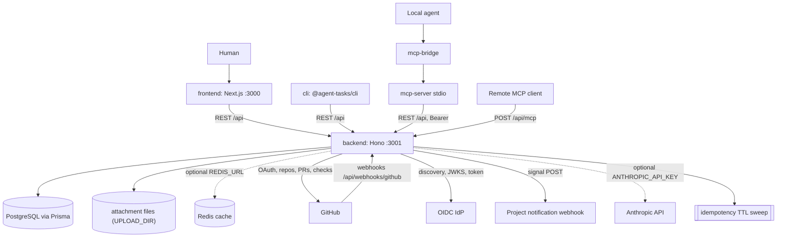

# Architecture

## Recommended Starting Shape

agent-tasks is a **modular monolith**: one backend process that serves the HTTP API, runs the workflow rules and owns the database, plus a frontend and three client packages.

Rationale:
- fast delivery in the current phase
- low operational complexity
- extraction paths stay open for later service splits

See also:
- `adr/0005-modular-monolith-as-starting-architecture.md`
- `adr/0006-relational-database-as-primary-store.md`
- `adr/0007-integrations-behind-internal-boundaries.md`

## Runtime Topology

- Frontend: Next.js app (`frontend/`, port 3000)
- Backend API: Hono + Node.js (`backend/`, port 3001)
- Primary DB: PostgreSQL + Prisma
- Optional cache: Redis (`REDIS_URL`; the backend falls back to an in-memory cache when unset)
- Attachment files: a disk directory (`UPLOAD_DIR`, `./uploads` when unset); the compose files mount a volume there, and the database holds only the attachment metadata
- Optional Docker dev stack: `docker-compose.yml` (db + redis + backend + frontend)
- Agent clients: `mcp-server` (stdio MCP server that calls the REST API with a Bearer token), `mcp-bridge` (resolves the token and starts `mcp-server`) and `cli` (REST client). Remote MCP clients use the backend's HTTP MCP endpoint `POST /api/mcp`, which serves a hand-maintained subset of the stdio tool surface.
- Inbound GitHub webhooks: `POST /api/webhooks/github` (see [webhook-setup.md](webhook-setup.md)).
- Outbound calls: the GitHub API (OAuth, repository list, pull request lookup, creation, comments and merge, checks), a team's OIDC identity provider (discovery, JWKS, token), project notification webhooks when a signal is created (see [notification-webhooks.md](notification-webhooks.md)), and the Anthropic API for the optional suggest-rewrite helper (see [llm-rewrite-helper.md](llm-rewrite-helper.md)).
- Startup: the backend composes the grounding runtime from `GROUNDING_RUNTIME_CONFIG` before it listens, and exits when that configuration or the database is not ready (see [grounding-migration.md](grounding-migration.md)). While running, it sweeps the idempotency dedup tables every 6 hours (retention `IDEMPOTENCY_TTL_DAYS`).

The diagram shows the deployables, how clients reach the backend, its stores and the external systems it calls.



## Logical Modules

### Frontend
- App Router pages (`frontend/src/app`)
- API client and transport helpers (`frontend/src/lib`)

### Backend
- Routes (`backend/src/routes`): parse and validate requests, check scopes and project access, and run most task-workflow rules (claim, dependency, confidence, review and merge checks) against Prisma directly.
- Services (`backend/src/services`): shared gates (`services/gates/`), governance and review gates, GitHub (OAuth, sync, checks, merge, webhooks), OIDC SSO, signals and notification webhooks, audit, idempotency and the grounding subsystem.
- Lib (`backend/src/lib`): governance-mode and enforcement-mode resolution, the confidence scorer, errors, logger and the Prisma client.
- Repositories (`backend/src/repositories`): Prisma access for agent tokens and teams only.
- Middleware (`backend/src/middleware`): authentication, rate limiting, request context, JSON body limit, error mapping.
- Config (`backend/src/config`): env validation (`config/index.ts`) and the grounding runtime configuration.

## Boundary Rules

- Workflow rules live where the code runs them: mostly in the route handlers, with shared checks factored into `services/gates/` and `services/`.
- Data access goes through Prisma; a repository layer exists only for agent tokens and teams.
- Integrations (GitHub, OIDC SSO, notification webhooks, the Anthropic API) stay behind service modules with explicit error paths.

## Security Model

- Humans sign in with email and password, GitHub OAuth (`/api/auth/github`) or team-scoped OIDC SSO (`backend/src/routes/sso.ts`), and can link GitHub to an existing account (`/api/auth/github/connect`). The browser sends the `session` cookie.
- `Authorization: Bearer` accepts an agent token (scoped, team-bound) or a human session JWT.
- SSO admin endpoints (`/api/teams/:teamId/sso`, `/api/sso/whoami`) accept only an agent token with the `sso:admin` scope for the same team; a session cookie alone cannot configure SSO.
- Team and project access and agent scopes are checked server-side; claims, transitions, merges and admin overrides write audit rows.
- Rate limits apply per client address to register, login, GitHub and SSO auth routes, `/api/mcp` and the suggest-rewrite endpoint. Set `TRUSTED_PROXY_HOPS` to the number of reverse proxies in front of the backend, and to `0` when there is none: the limiter reads the client address from `X-Forwarded-For` that many entries from the right. `.env.example` ships `1` for a deployment behind one proxy.
- `ALLOWED_GITHUB_LOGINS` restricts which GitHub logins the identity-broker endpoint `POST /api/auth/register-from-project-pilot` provisions; empty accepts any verified GitHub user.
- With `GITHUB_WEBHOOK_SECRET` set, the GitHub webhook route verifies the signature of every delivery. Without it, the route accepts unsigned payloads unless `NODE_ENV=production`, which rejects them with `401`. The Docker quick start runs `NODE_ENV=development`, so set `GITHUB_WEBHOOK_SECRET` on any instance GitHub can reach (see [webhook-setup.md](webhook-setup.md)).
- `/api/mcp` takes the same Bearer authentication as the REST API.

## Data and Consistency

- Relational model in PostgreSQL (`backend/prisma/schema.prisma`), applied with `prisma db push` (the production one-shot runs it without `--accept-data-loss`, so a destructive change stops the deploy; see `docs/ops-backups.md`); there is no migrations directory.
- GitHub webhook deliveries are deduplicated by delivery id (`WebhookDelivery`), and side-effecting GitHub verbs such as `pull_requests_merge` accept an optional idempotency key (`ToolInvocation`); the TTL sweep prunes both tables.
- Claim and transition conflicts are handled explicitly (`409`).

## Evolution Path

Planned work is tracked in [roadmap.md](roadmap.md).

## Diagrams

- System architecture: `diagrams/architecture-overview.mmd` (the diagram under Runtime Topology)
- Domain overview: `diagrams/domain-overview.mmd`

## Repository layout

```
agent-tasks/
├── backend/          # Hono API (port 3001)
│   ├── src/
│   │   ├── routes/        # HTTP handlers
│   │   ├── services/      # Domain / authz logic
│   │   ├── repositories/  # Persistence access
│   │   ├── middleware/    # Auth, error handling
│   │   └── config/        # Env config
│   └── prisma/            # schema.prisma (applied with prisma db push) + grounding fence SQL
├── frontend/         # Next.js app (port 3000)
│   └── src/
│       ├── app/           # App Router pages
│       └── lib/           # API client
├── mcp-server/       # @agent-tasks/mcp-server, stdio MCP wrapper for agents
│   └── src/
│       ├── client.ts      # Bearer-auth HTTP client for the REST API
│       ├── server.ts      # Library entry (createServer / runStdioServer)
│       └── tools.ts       # Tool definitions (projects, tasks, signals)
├── mcp-bridge/       # @agent-tasks/mcp-bridge, npx-distributable bridge
│   └── src/                #   with keychain login, wraps mcp-server
│       ├── cli.ts         # CLI entry (serve | login | logout | status)
│       ├── login.ts       # Token prompt + backend validation
│       └── token-store.ts # env / keychain / file fallback
├── cli/              # @agent-tasks/cli, command-line client
├── scripts/          # Grounding deployment / receipt-contract checks
├── tools/            # Docker smoke override + script, Jira import
├── docs/             # Specs (this directory)
└── .github/          # CI workflows
```

## Surface map (UI pages)

| Route | Purpose |
|-------|---------|
| `/` | Landing page; signed-in users go to `/onboarding` only when they have neither a team nor a shared project (`needsOnboarding` in `frontend/src/lib/access.ts`), else to `/home` |
| `/auth` | Login / Register |
| `/auth/error` | Login error page |
| `/onboarding` | First team creation; optional (a "Skip for now" link) when you already have shared projects. `/onboarding?create=team` opens the same form for a user who already has a team (header "+ New team" and the account menu's "New team"); it is not redirected to `/home`, and after creating, the new team is remembered and its Home opens |
| `/home` | Signed-in start page: the team's tasks across projects; without a team, the projects shared with you |
| `/projects` | Projects list (project management, GitHub sync); `?teamId=<id>` pre-selects a team |
| `/tasks` | Task list |
| `/tasks/[id]` | Task detail |
| `/projects/[id]` | Legacy hub root: redirects to `/projects/<id>/board`, query kept |
| `/projects/[id]/board` | Board + list view, task CRUD |
| `/projects/[id]/settings` | Project settings |
| `/projects/[id]/members` | Project members |
| `/projects/[id]/workflow` | Workflow editor (states, transitions, agent instructions) |
| `/settings` | Personal settings: account, appearance, GitHub connection, agent permissions |
| `/settings/team` | Team settings: API tokens (Connect an agent, create, rename, revoke) and the Enterprise SSO entry |
| `/settings/team/sso` | Team OIDC SSO connection; the old `/settings/sso` redirects here |
| `/invite/[token]` | Accept a project share |
| `/docs` | Interactive Swagger UI (served by backend) |

Legacy redirects: `/dashboard` goes to `/projects/<id>/board` (its `projectId`, else the last board opened in the browser), else `/projects`; `/teams?teamId=<id>` goes to `/projects?teamId=<id>` and `/settings/sso` goes to `/settings/team/sso` (both `next.config.mjs` redirects, query string preserved); `/projects/workflow?projectId=<id>` goes to `/projects/<id>/workflow`, `/teams/tokens` goes to `/settings/team`, and the old `/settings#api-tokens` and `/settings#sso` anchors are forwarded client-side to `/settings/team#api-tokens` and `/settings/team#sso`. `/dev/ui` is a developer component gallery.
