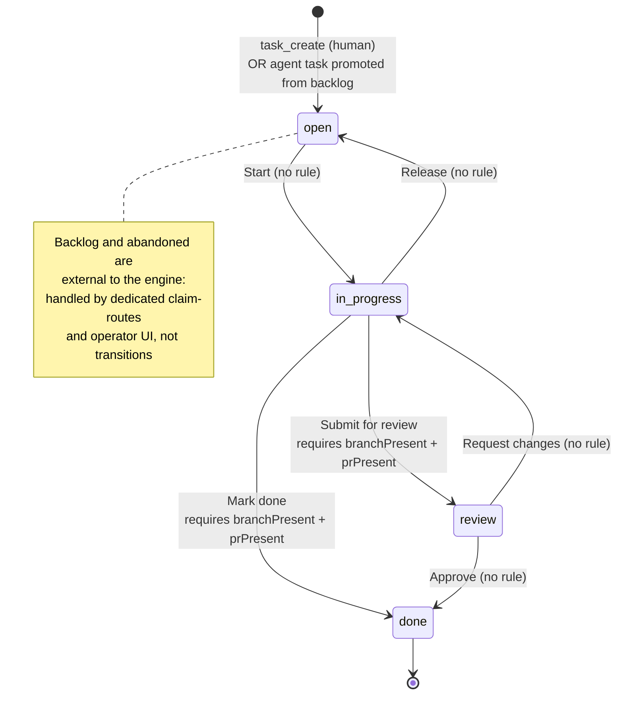
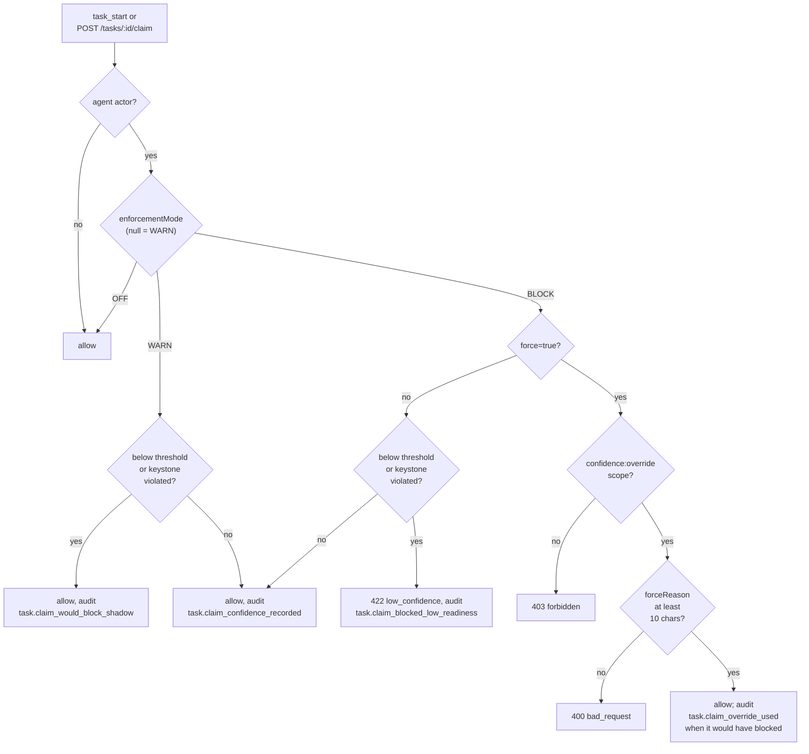

# State machines

Authoritative source: [`backend/src/services/default-workflow.ts`](../backend/src/services/default-workflow.ts), [`backend/src/services/transition-rules.ts`](../backend/src/services/transition-rules.ts), [`backend/src/lib/governance-mode.ts`](../backend/src/lib/governance-mode.ts), [`backend/src/services/gates/`](../backend/src/services/gates/). This page documents the default workflow plus the gates that run on every transition regardless of workflow.

## Default workflow

The product status vocabulary includes six values. The workflow engine itself, implemented in `DEFAULT_TRANSITIONS` below, defines only four states: `open`, `in_progress`, `review`, and `done`. `Task.status` is a free `String` column, but the workflow API accepts only these four states for any workflow, default or custom (`FIXED_STATE_NAMES` in `backend/src/routes/workflows.ts`); custom workflows change transitions and gates, not states. The default workflow:

Agent-created tasks land in `backlog` status (handled outside the workflow engine via dedicated routing in `task_start` and claim routes) for human operator review before they can enter the standard workflow. Human-created tasks and promoted backlog tasks default to `open`. The standard workflow then proceeds `open → in_progress → review → done` with branching for release and request-changes.

`open → in_progress` deliberately has no precondition, so exploratory work without a branch is allowed. Gates only attach on `→ review` and `→ done`. Backlog tasks are invisible to `task_pickup` and cannot be claimed until promoted to `open` by a human via `PATCH`; see `docs/okf/claim-model.md` and `docs/okf/task-lifecycle.md` for the full backlog contract. `abandoned` is not a workflow transition target. It is set when a human discards a backlog task, or when an agent withdraws an `open` or `backlog` task it created, with no claim on it, via `task_creator_abandon`; a project admin can restore an abandoned task to the initial state with `PATCH /tasks/:id`.

## Transition-rule layer

Four reusable rules live in `transition-rules.ts` and decorate transition edges that need them:

| Rule | What it checks | Notes |
|---|---|---|
| `branchPresent` | `Task.branchName` is non-empty | Sync. Set via `task_submit_pr` or PATCH. |
| `prPresent` | `Task.prNumber` is non-empty | Sync. Set via `task_submit_pr` or PATCH. |
| `ciGreen` | GitHub Check Runs on the bound PR are all green | Hits the GitHub API. **Fails closed** on missing token or network error. |
| `prMerged` | The bound PR is merged | Hits the GitHub API. Fails closed on missing token or network error. |

Custom workflows can attach any subset of the four rules to any transition. The default workflow only attaches `branchPresent + prPresent` to the two `in_progress → ...` edges.

`force=true` from a project admin (team `ADMIN` or per-project `PROJECT_ADMIN`) bypasses every rule. The bypass is audit-logged as `task.transitioned.forced` and emits a `task_force_transitioned` signal to the claimant + active reviewer.

## Governance-tier gates

These run on every state-write path (transition, PATCH `{ status }`, `task_finish`, REST merge, `task_merge`). The active set depends on `Project.governanceMode`:

| Tier | Self-review (`review → done` by claimant) | Self-merge (`pull_requests_merge` / `task_merge` / `task_finish` by claimant) | Side effect on success |
|---|---|---|---|
| `AUTONOMOUS` | allowed | allowed | none |
| `AWAITS_CONFIRMATION` | allowed | allowed | `self_merge_notice` signal to every human team member |
| `REQUIRES_DISTINCT_REVIEWER` | rejected with `403 forbidden` (audit `task.review_rejected_self_reviewer`) | rejected with `403 self_merge_blocked` (audit `task.pr_merged.blocked_self_merge`) on a task not enrolled in Grounding; on a task enrolled in Grounding (any Grounding cohort, including admin-migrated tasks), `403 forbidden` with the message `Self-merge is blocked: a distinct reviewer must merge` (no audit entry) | none |

`AWAITS_CONFIRMATION` is the async-HITL middle ground: the agent is not blocked, but every human on the team gets a notification they can act on.

## Server-derived governance

`Project.soloMode` and `Project.requireDistinctReviewer` are deprecated. Read paths go through `resolveGovernanceMode` (`backend/src/lib/governance-mode.ts`); writes go through the new enum and sync-write the legacy columns via `legacyFlagsFromGovernanceMode` for one release of backward compat.

Inviting a second human into a soloMode project auto-flips the project off `AUTONOMOUS` (`project.solo_mode_disabled_by_share` audit row) so the distinct-reviewer gate becomes meaningful the moment a second reviewer exists.

## Merge-event paths

Two paths reach the task and they can land it in different states:

| Path | How it fires | Resulting `status` |
|---|---|---|
| REST merge | `task_merge` (`POST /api/tasks/:id/merge`) or `pull_requests_merge` (`POST /api/github/pull-requests/:prNumber/merge`) | `done` after a successful merge |
| Webhook merge | PR merged through the GitHub UI or `gh pr merge` | `pickMergeTargetStatus`: `done` for `AUTONOMOUS`; in any other mode, with or without a custom workflow, a task that is neither review-like nor terminal moves to the workflow's first review-like state (`review` in the built-in workflow) and a task already in a review-like state stays there; `done` and `backlog` tasks are not matched in any mode |

Only the REST paths run the self-merge gate. The webhook path records a merge that already happened on GitHub; it takes the target from the task's effective workflow (its first review-like state, or its first terminal state for `AUTONOMOUS`) and writes it without checking it against the workflow's transitions. Tooling that wraps both must treat them as separate code paths.

## Confidence gate

The confidence gate runs when an agent claims an open task (`task_start`, `POST /api/tasks/:id/claim`). `task_pickup` does not filter by confidence. Its effect depends on `Project.enforcementMode`: `OFF` skips scoring; `WARN` (the value when the column is unset) scores the task, lets a would-block claim through and records `task.claim_would_block_shadow`; `BLOCK` rejects a claim that scores below the effective threshold, or that violates a keystone, with `422 low_confidence`. The effective threshold is `taskTypeThresholds[taskType]`, else `confidenceThreshold` (default `60`), else the global default `60`, plus any triggered `riskModifiers`. Under `BLOCK`, `?force=true&forceReason=...` (at least 10 characters) overrides the gate only for a token with the `confidence:override` scope. Human claims are never gated. See [`scorer-v2-enforcement.md`](scorer-v2-enforcement.md).

The flowchart shows when an agent claim is allowed, shadow-logged, blocked or overridden.

`task_pickup` skips tasks until every `blockedBy` parent reaches a resolved status (`done` or `abandoned`), and `task_start` rejects such a claim with `409 blocked`, so the dependency graph is enforced at claim time, not at transition time.

## Further reading

- [`workflow-preconditions.md`](workflow-preconditions.md), full reference for the precondition rule layer.
- [`governance.md`](governance.md), confidence scoring, governance modes, audit behaviour.
- [`events.md`](events.md), every audit action + signal type emitted on these state changes.
