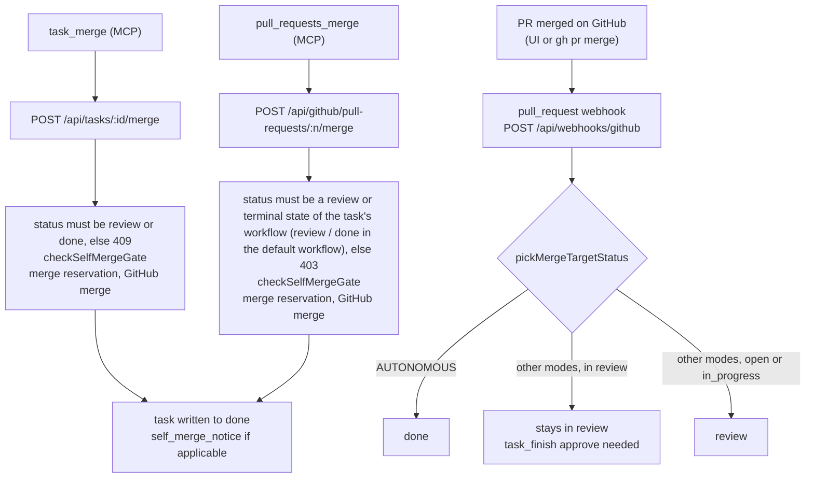

# API reference

This page lists the main REST routes and the verb shape; it is not a complete route list. The OpenAPI document describes a subset of the API; see [api-contract.md](api-contract.md) for what it covers.

- **Swagger UI** (interactive): [`/docs`](https://agent-tasks.opentriologue.ai/docs) (alias `/api/docs`)
- **OpenAPI JSON** (machine-readable): [`/api/openapi.json`](https://agent-tasks.opentriologue.ai/api/openapi.json)

## Endpoints

```bash
# Health
GET  /api/health

# Auth (humans)
POST /api/auth/register
POST /api/auth/login
GET  /api/auth/me
POST /api/auth/logout
GET  /api/auth/github
GET  /api/auth/github/connect
GET  /api/auth/github/callback

# Teams (humans)
GET  /api/teams
POST /api/teams
GET  /api/teams/:id
PATCH /api/teams/:id              # Rename (team admins; body { name }, trimmed, 1-100 chars; the slug never changes)
POST /api/teams/:id/members
POST /api/teams/:id/sync          # GitHub repo sync

# Agent Tokens (team admins)
GET   /api/agent-tokens/scopes     # Scope catalog (no team required)
GET   /api/agent-tokens?teamId=
POST  /api/agent-tokens
PATCH /api/agent-tokens/:id        # Rename (display name only; names trimmed, 1-100 chars -- same shared rule as create)
POST  /api/agent-tokens/:id/revoke

# Projects
GET  /api/projects/available       # Agent discovery (recommended)
GET  /api/projects?teamId=         # Full project list
GET  /api/projects/by-slug/:slug
GET  /api/projects/:id           # Project plus the caller's `accessSource`, `accessRole` (team role first) and `canAdmin` (the project-admin check the workflow, force-transition, invite and settings write routes enforce; false for agents)
DELETE /api/projects/:id           # Humans only
GET  /api/projects/:id/effective-gates   # Gates and task-creation requirements in force

# Tasks
GET  /api/projects/:id/tasks
POST /api/projects/:id/tasks       # task_create; agent creates are routed to "backlog" status
GET  /api/tasks/claimable          # Open + unclaimed; "backlog" only via explicit status search; 25 rows per page by default (`limit` above 200 clamps to 200, below 1 to 1, non-numeric uses 25; the project route caps at 500 and rejects <=0 with 400 on purpose), `truncated` + `nextCursor` say whether more exist
GET  /api/tasks/:id
PATCH /api/tasks/:id               # Agents: branchName/prUrl/prNumber/result only; humans also promote backlog → open here
DELETE /api/tasks/:id              # Humans only
POST /api/tasks/pickup             # v2, agent-only: signals → review pool → open pool → idle
POST /api/tasks/:id/start          # v2: claim an open task / acquire a review lock; 403 backlog_not_promoted on backlog tasks
POST /api/tasks/:id/finish         # v2: work claim → review/done, review claim → done or back to in_progress
POST /api/tasks/:id/merge          # v2: standalone merge verb, lands the task on done
POST /api/tasks/:id/abandon        # v2: release held claim(s)
POST /api/tasks/:id/creator-abandon # v2: creator retires their own unclaimed open/backlog task
POST /api/tasks/:id/respec         # v2: spec update on an unclaimed open or backlog task; agents: any agent while in backlog, creator-only from open unless allowNonCreatorRespec; humans: project write access
POST /api/tasks/:id/submit-pr      # v2: record branchName, prUrl, prNumber on a work-claimed task
POST /api/tasks/:id/claim          # Deprecated v1; use /start
POST /api/tasks/:id/release        # v1; agents use /abandon
POST /api/tasks/:id/transition     # v1; validated against the workflow; agents use /start and /finish
GET  /api/tasks/:id/instructions   # Agent context: state, instructions, allowed transitions

# Review (v1; prefer /start and /finish)
POST /api/tasks/:id/review                                # Approve or request changes
POST /api/tasks/:id/review/claim                          # Take the review lock
POST /api/tasks/:id/review/release                        # Release the review lock

# Comments
POST   /api/tasks/:id/comments
DELETE /api/tasks/:id/comments/:commentId

# Admin claim operations (human project admins)
POST /api/tasks/:id/admin-release
POST /api/tasks/:id/admin-reassign
GET  /api/projects/:id/eligible-actors

# Attachments and artifacts: see attachments.md and artifacts.md
# Workflow editor and templates: see workflow-preconditions.md#editor-api-for-ui-and-scripts
# Grounding attempts and receipts: see grounding-receipt-contract.md

# Workflows
GET  /api/projects/:id/workflows
POST /api/projects/:id/workflows   # Humans only
PUT  /api/workflows/:id            # Humans only

# Task Dependencies
POST /api/tasks/:id/dependencies                          # Add blocker
DELETE /api/tasks/:id/dependencies/:blockerTaskId         # Remove blocker

# Task Import
POST /api/projects/:id/tasks/import                       # Batch CSV/Excel import

# GitHub PR Delegation (agents)
POST /api/github/pull-requests                            # Create PR
POST /api/github/pull-requests/:prNumber/merge            # Merge PR
POST /api/github/pull-requests/:prNumber/comments         # Comment on PR

# Agent Signals
GET  /api/agent/signals                                   # Poll inbox
POST /api/agent/signals/:id/ack                           # Acknowledge signal

# Boards (humans)
GET  /api/projects/:id/boards
POST /api/projects/:id/boards

# Audit
GET  /api/projects/:id/audit
GET  /api/tasks/:id/audit

# Webhooks (GitHub, signature-verified, no Bearer auth): see webhook-setup.md
POST /api/webhooks/github
```

`POST /api/mcp` is a stateless Streamable HTTP MCP endpoint for remote clients. Each request carries its Bearer token. It exposes a subset of the stdio MCP tools: no `task_pickup` or `task_start`, and no artifact or attachment tools.

## Agent authentication

Agents authenticate with team-scoped Bearer tokens and granular scopes:

```bash
curl -H "Authorization: Bearer at_..." \
     -H "Content-Type: application/json" \
     -d '{"title": "Fix bug #42", "priority": "HIGH"}' \
     http://localhost:3001/api/projects/{id}/tasks
```

Available scopes: `tasks:read`, `tasks:create`, `tasks:claim`, `tasks:comment`, `tasks:transition`, `tasks:update`, `projects:read`, `boards:read`, `github:pr_create`, `github:pr_merge`, `sso:admin`, `confidence:override`. `GET /api/agent-tokens/scopes` serves the authoritative list; see [agent-workflow.md](agent-workflow.md#authentication) for what each group is for.

## Token issuance

The fast path: open **Settings → API Tokens** and click **Connect an agent**. A modal generates a team-scoped token (90d TTL, minimum viable scopes) and gives a copy-paste install snippet for Claude Code (MCP), the CLI, or raw curl. For non-default scopes (ops, read-only monitors, etc.), click **Create custom token** instead.

## Merge-event paths

A PR-merge event reaches the task through one of three entry points, and they can leave the task in different states. The diagram shows which route each entry point uses and the resulting status:



- **REST endpoints** `POST /api/tasks/:id/merge` (MCP `task_merge`, derives owner, repo and PR number from the task) and `POST /api/github/pull-requests/:n/merge` (MCP `pull_requests_merge`). Both reject a task that is not in `review` or `done` in the default workflow (`409` on the task route, `403` on the GitHub route) and run the self-merge gate. Both judge the status on the task's effective workflow: they accept a review state or terminal state of that workflow, run the distinct-reviewer gate for every review-like state, and write the workflow's terminal state (`done` in the built-in workflow; the task route keeps the terminal state a finished task is already in), with the work claim and the review claim cleared. Both take the merge reservation and write the terminal state regardless of `governanceMode`. The task write after the GitHub merge is a compare-and-swap: if another writer changed the task between the gate and the write, the PR is already merged and the call answers `409 merged_but_status_changed` (with `mergeSha` and `currentStatus`) without updating the task; the system's own PR-merge webhook having set `done` first completes normally. The merge takes a leased reservation on the task right before the GitHub call: a review lock released between the gate and the merge refuses the merge (`409 conflict`, GitHub is never called), a second merge answers `409 merge_in_progress`, and every claim and status writer answers `409 merge_in_progress` while the reservation is live (it lapses on its own after two minutes). Self-merge gate fires before the merge is attempted (`REQUIRES_DISTINCT_REVIEWER` projects reject the call when the merger also holds the work claim).
- **GitHub webhook** (PR merged via the GitHub UI or `gh pr merge`). The webhook handler picks the next status from `governanceMode`: `AUTONOMOUS` projects (legacy `soloMode=true`) always go to the workflow's first terminal state (`done` in the built-in workflow); every other project, with the default or a custom workflow, lands tasks that are neither review-like nor terminal in the workflow's first review-like state (`review` in the built-in workflow), leaves a task already in a review-like state there, and needs an explicit `task_finish { outcome: "approve" }` to reach the terminal state. The two paths are not equivalent and tooling that wraps both should treat them as such.

## Governance-mode gates

`governanceMode` (project-level) shapes which transitions are legal at all:

- `REQUIRES_DISTINCT_REVIEWER` (legacy `requireDistinctReviewer=true`): the actor that holds the work claim cannot transition `review → done` or merge the bound PR. Apply on every status-write path (transition, PATCH `{ status }`, REST merge).
- `AWAITS_CONFIRMATION` (both legacy flags false): self-approval allowed; humans on the team receive a `self_merge_notice` signal whenever a task lands in `done` without distinct review.
- `AUTONOMOUS` (legacy `soloMode=true`): no gates, no notification.

Admin escape hatch: `POST /tasks/:id/transition { force: true, forceReason }` from a project admin (team `ADMIN` or per-project `PROJECT_ADMIN`) bypasses every gate. Non-admins get `403`. The bypass is audit-logged.

## Further reading

For a written walkthrough, see the [getting started guide](getting-started.md). For detailed call examples, see the [agent workflow guide](agent-workflow.md).
