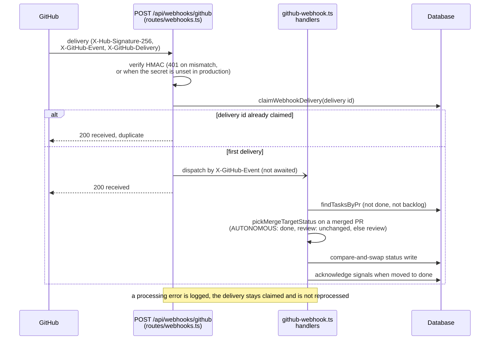

# Webhook setup guide

How to connect GitHub webhook events to agent-tasks for automatic PR lifecycle sync.

**This is entirely optional.** Without webhooks, everything works manually — agents and humans claim tasks, set PR fields, and transition status themselves. Webhooks add automated timeline entries and status transitions.

## What you get

- **Activity timeline**: PR opened, review approved, changes requested, merged etc. appear in the task detail UI
- **Auto-transitions**: "changes requested" sends a task back to `in_progress`; PR merged moves it to `done` in `AUTONOMOUS` projects and to `review` otherwise; a closed issue moves its `[GH #N]` task to `done`
- **PR binding**: tasks are matched to PRs via a 4-tier strategy: `prNumber` → `prUrl` → `branchName` → title pattern `[PR #N]`

See [review-automation-policy.md](review-automation-policy.md) for the full event → side-effect matrix.

## 1. GitHub App permissions

The GitHub App needs these **repository permissions**:

| Permission | Level | Why |
|---|---|---|
| Contents | Read & write | Push events, branch sync |
| Pull requests | Read & write | PR events, create PRs |
| Issues | Read & write | Issue lifecycle sync |
| Metadata | Read-only | Repo discovery |
| Workflows | Read & write | CI status |
| Administration | Read & write | Only if managing repo webhooks via API |

After changing permissions, the installation owner must **accept the new permissions** at `https://github.com/settings/installations` — look for the "review and accept" banner. Until accepted, new permissions are not active on installation tokens.

## 2. App-level webhook

Configure the webhook on the **GitHub App itself** (not per-repo). This covers all repositories where the app is installed — no per-repo setup needed.

In your GitHub App settings → General → Webhook:

| Field | Value |
|---|---|
| Active | Yes |
| Webhook URL | `https://your-domain.com/api/webhooks/github` |
| Content type | `application/json` |
| Secret | A random string (same as `GITHUB_WEBHOOK_SECRET` below) |
| SSL verification | Enable |

Under "Permissions & events" → "Subscribe to events", enable:
- **Pull request**
- **Pull request review**
- **Push**
- **Issues** (optional: an opened issue creates a task, a closed issue completes it; see the matrix below)

**Why app-level instead of per-repo?** GitHub App installations on user-owned repos cannot manage webhooks via API (403). An app-level webhook covers all repos automatically and requires no per-repo configuration.

## 3. Server environment

Generate a webhook secret and configure the server:

```bash
# Generate secret
openssl rand -hex 32

# Add to server .env
GITHUB_WEBHOOK_SECRET=<the-generated-secret>

# Restart backend
docker compose -f docker-compose.prod.yml up -d backend
```

In development, `GITHUB_WEBHOOK_SECRET` can be left empty — the server accepts unsigned payloads in dev mode. In production, all unsigned payloads are rejected with 401.

## With external grounding enabled

When `GROUNDING_RUNTIME_CONFIG` is set, the same URL and secret are served by the grounding webhook service instead of the handlers described below. A repeated delivery returns its stored result, and a database or audit failure rolls back and lets GitHub retry (`503 grounding_webhook_pending`). Merged-PR and issue-close events for provisioned tasks are recorded as pending observations instead of completing the task. See [grounding-receipt-contract.md, "Configured GitHub webhook observations"](grounding-receipt-contract.md#configured-github-webhook-observations).

## Event → side-effect matrix

| GitHub event | Precondition | Task transition | Timeline entry |
|---|---|---|---|
| `pull_request_review` (approved) | Any | None | "Review approved by {reviewer}" |
| `pull_request_review` (changes requested) | Task in `review` | `review → in_progress` | "Changes requested by {reviewer}" |
| `pull_request_review` (commented) | Any | None | "Review comment by {reviewer}" |
| `pull_request_review` (dismissed) | Any | None | "Review dismissed for {reviewer}" |
| `pull_request` (merged) | Task not `done` or `backlog` | `governanceMode: AUTONOMOUS`: `* → done`; any other mode: `open`/`in_progress → review`, `review` unchanged (approval through `task_finish` still required) | "PR #N merged by {user}" |
| `pull_request` (closed, no merge) | Task not `done` or `backlog` | None | "PR #N closed without merge" |
| `pull_request` (opened) | No matching task | None, no task is created (an audit row `task.reviewed` with `event: pr_opened_unmatched` is written) | None |
| `pull_request` (opened) | Matching task found | Backfills prNumber/prUrl/branchName where unset | "PR #N opened: {url}" |
| `issues` (opened) | Project `githubRepo` equals the repo | Creates task `[GH #N] <title>` in `open` | None |
| `issues` (closed) | Task titled `[GH #N]`, not `done` or `backlog` | `* → done` | None |
| `push` | — | None | Updates project sync timestamp |

## How a delivery is processed

The sequence below shows the order of the signature check, the delivery dedup, the early `200` and the asynchronous dispatch, and where a merged PR's target status is chosen:



Delivery semantics:

- The endpoint answers `200` before the event is processed, so a green entry in Recent Deliveries does not prove that the side effect ran.
- Each `X-GitHub-Delivery` id is processed at most once. A redelivery of the same id answers `{ "received": true, "duplicate": true }` and does nothing.
- A delivery whose processing failed is logged (`error processing webhook event`) and not retried.
- Dedup records expire after `IDEMPOTENCY_TTL_DAYS` (default 30).

## Task ↔ PR binding

When a webhook event arrives, agent-tasks matches it to a task using this priority:

1. **`prNumber`**: strongest match, set by agents via `task_submit_pr` (`POST /api/tasks/:id/submit-pr`) or `PATCH /api/tasks/:id`
2. **`prUrl`**: set by agents or backfilled from webhook
3. **`branchName`**: matches the PR's head branch (`head.ref`)
4. **`title pattern`**: legacy fallback, matches `[PR #N]` in task title

Results are deduplicated across all strategies. Only tasks that are not `done` or `backlog` are returned.

**For reliable binding, agents should always set `prNumber` and `branchName` on their tasks.**

## Verifying the setup

After configuration, GitHub sends a `ping` event. Check deliveries:
- GitHub App settings → Advanced → Recent Deliveries
- Or via API: `GET /app/hook/deliveries` (requires JWT auth)

Then check an end-to-end PR binding:
1. Create a task and start it, passing `branchName` to `task_start` (or set it afterwards with `PATCH /api/tasks/:id { branchName }`).
2. Open a PR from that branch on the connected repo.
3. Check that the task has `prNumber` and `prUrl` set and that its Activity timeline shows "PR #N opened".

## Troubleshooting

| Problem | Cause | Fix |
|---|---|---|
| 401 on webhook delivery | `GITHUB_WEBHOOK_SECRET` mismatch or not set | Ensure server env matches the secret in App settings |
| Events delivered but no task updated | No task matches the PR by `prNumber`, `prUrl`, `branchName` or a `[PR #N]` title, or the project `githubRepo` is not the repo full name | Set `githubRepo` to `owner/repo` and record the branch or PR on the task |
| Delivery succeeds but no side effects | Event type not subscribed or action not handled | Check event subscriptions in App settings |
| Delivery shows 200 but nothing changed | Processing runs after the response | Check the backend log |
| Redelivered event has no effect | Deliveries are processed at most once per delivery id | Apply the change manually |
| 403 when creating repo-level webhooks | GitHub Apps can't manage hooks on user-owned repos | Use app-level webhook instead (this guide) |
| New permissions not working | Installation hasn't accepted updated permissions | Accept at github.com/settings/installations |
